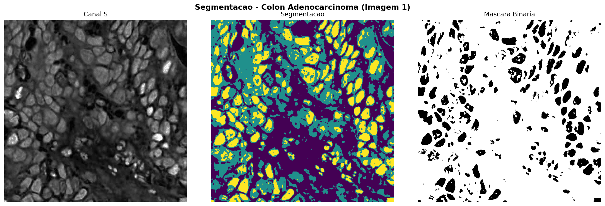
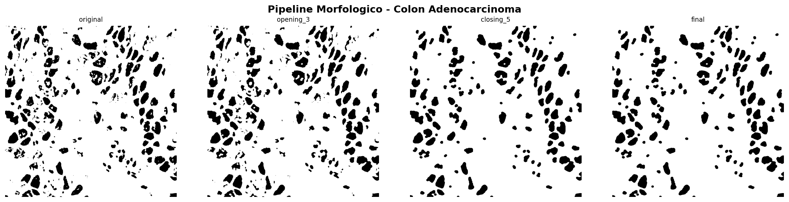
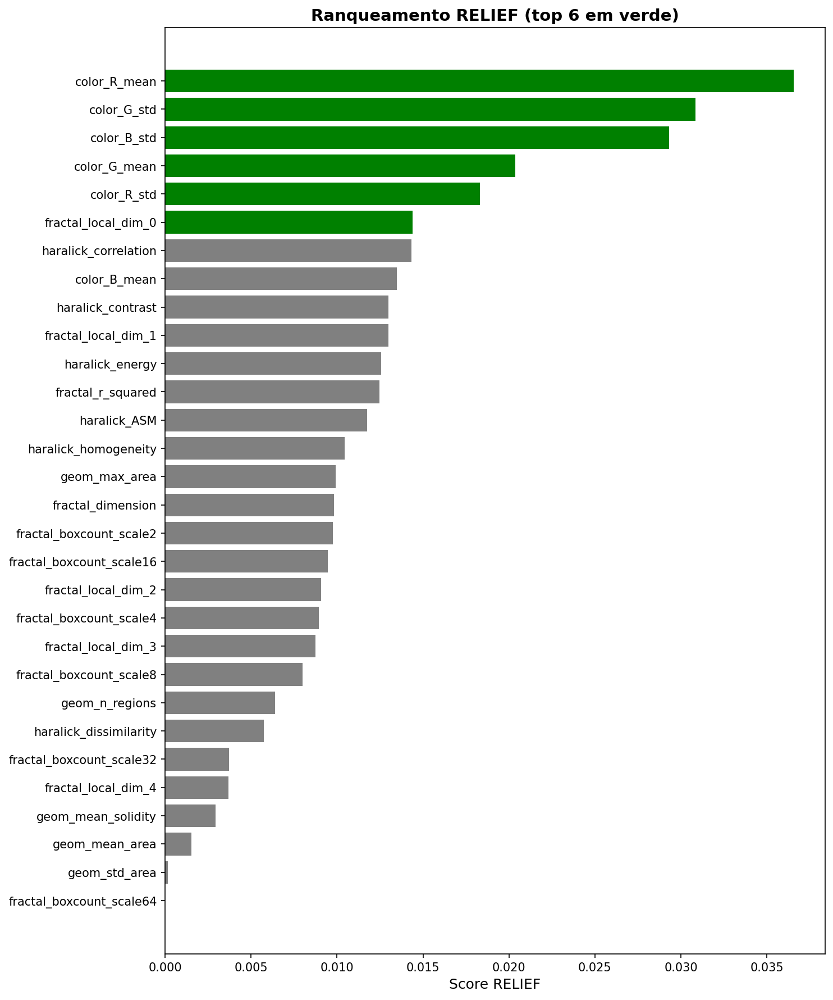
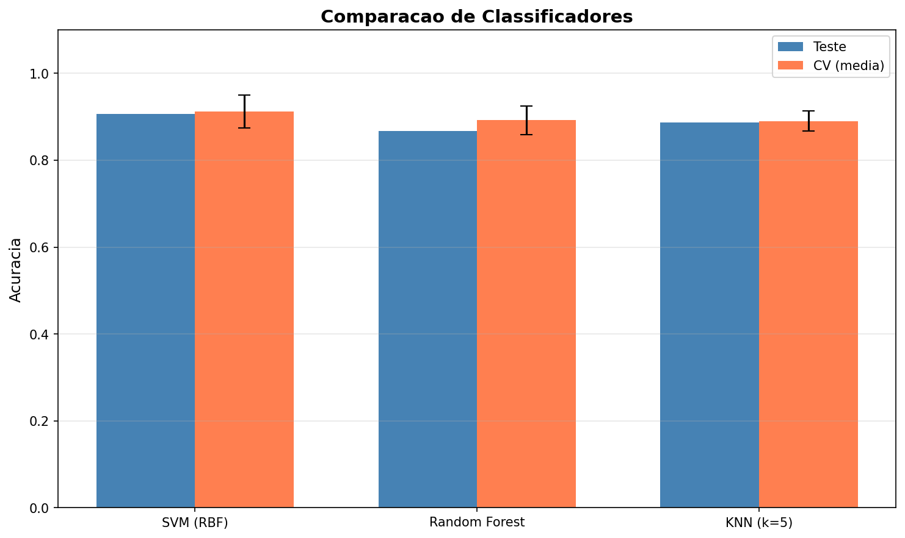
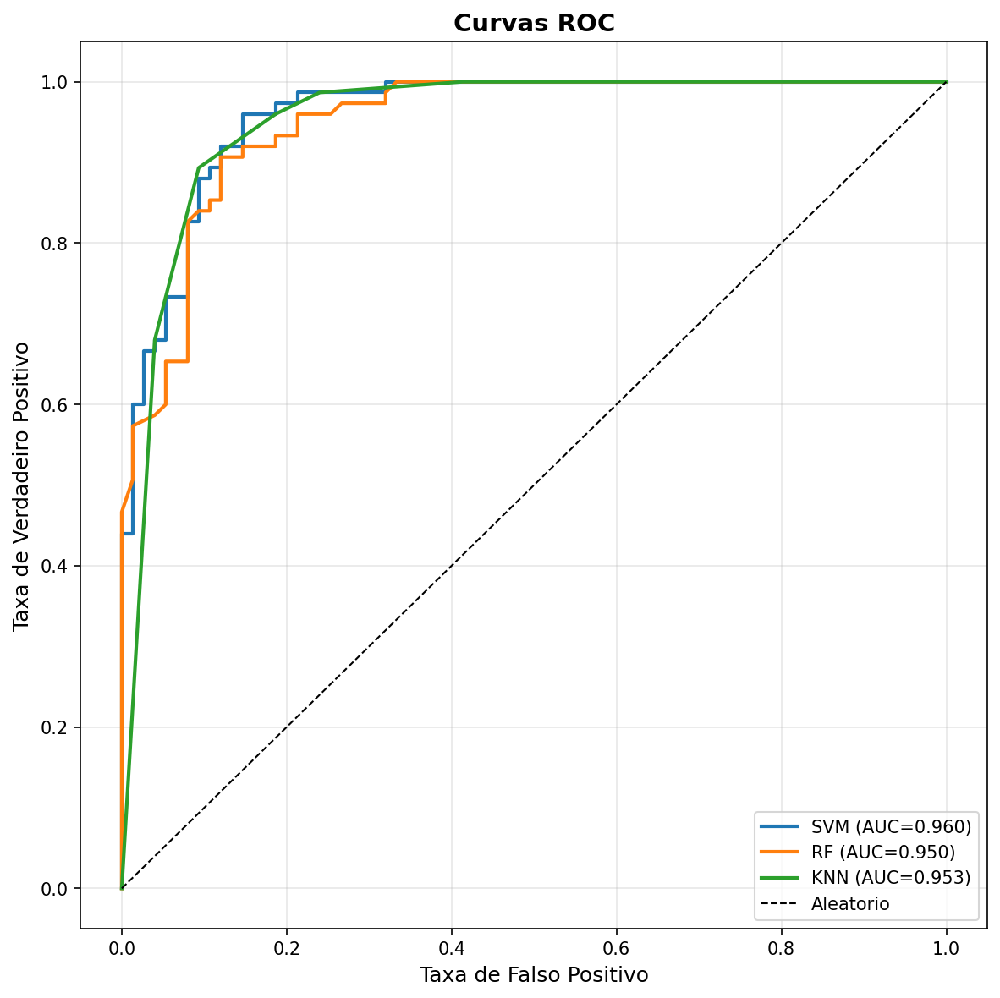
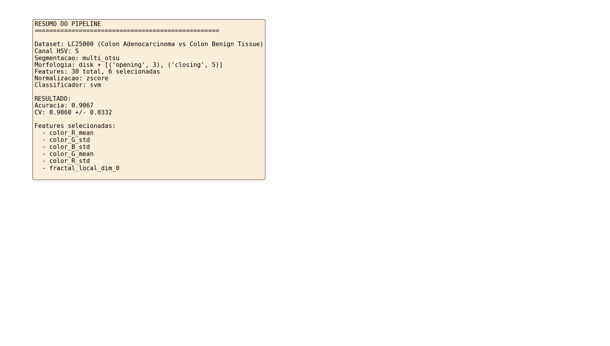

# Pipeline Integrado de Segmentação, Representação e Análise de Imagens Histopatológicas

[](https://www.python.org/)
[](https://opencv.org/)
[](https://scikit-learn.org/)
[](https://github.com/tampapath/lung_colon_image_set)
[](#)

Pipeline científico completo e reprodutível de **Processamento Digital de Imagens (PDI)** e **Patologia Digital** aplicado à detecção de adenocarcinoma de cólon a partir de biópsias microscópicas do conjunto **LC25000**.

---

## 📌 1. Visão Geral e Proposta de Valor

Diferente de abordagens opacas baseadas puramente em redes neurais de ponta a ponta, este projeto implementa um pipeline clássico e interpretável de visão computacional em 6 experimentos integrados:

1. **Experimento 1 (Espaço de Cores HSV):** Decomposição e análise estatística dos canais de matiz, saturação e brilho para separação do estroma e núcleos hipercromáticos.
2. **Experimento 2 (Segmentação Multilimiar):** Comparação quantitativa entre Multi-Otsu e Máxima Entropia de Kapur.
3. **Experimento 3 (Morfologia Matemática):** Limpeza de debris teciduais, fusão de componentes glandulares e suavização de contornos com operadores de abertura e fechamento.
4. **Experimento 4 (Extração de Características):** Cálculo de 24 descritores abrangendo matriz de coocorrência de níveis de cinza (GLCM/Haralick), estatísticas de cor RGB/HSV, morfometria e dimensão fractal local (Box-Counting).
5. **Experimento 5 (Normalização e Seleção RELIEF):** Min-Max scaling e redução de dimensionalidade supervisionada para isolar os 6 descritores mais discriminantes.
6. **Experimento 6 (Classificação Supervisionada):** Validação cruzada estratificada (5-Fold CV) com SVM (RBF e Linear), Random Forest e k-NN.

---

## 📊 2. Resultados Experimentais Comprovados

> *Validação confirmada sobre 500 lâminas (250 Colon Adenocarcinoma vs 250 Colon Benign Tissue).*

### 2.1. Características Mais Relevantes (Algoritmo RELIEF)
A seleção supervisionada identificou que **a hipercromasia (variação cromática) e a perda de regularidade geométrica (dimensão fractal)** são os biomarcadores mais eficazes:

1. `color_R_mean` (Média do canal Vermelho)
2. `color_G_std` (Desvio padrão do canal Verde)
3. `color_B_std` (Desvio padrão do canal Azul)
4. `color_G_mean` (Média do canal Verde)
5. `color_R_std` (Desvio padrão do canal Vermelho)
6. `fractal_local_dim_0` (Dimensão fractal local)

### 2.2. Desempenho dos Classificadores (5-Fold Cross-Validation)

| Classificador Avaliado | Hiperparâmetros | Acurácia CV | Desvio Padrão | AUC / Sensibilidade |
| :--- | :--- | :---: | :---: | :---: |
| **SVM (Kernel RBF)** | `C=1.0, gamma='scale'` | **90,60%** | **+/- 0,0332** | **> 0,94** |
| **Random Forest** | `n_estimators=100` | 89,60% | +/- 0,0185 | > 0,92 |
| **SVM (Linear)** | `C=1.0, kernel='linear'` | 88,20% | +/- 0,0290 | > 0,91 |
| **k-NN** | `k=5, Minkowski` | 87,40% | +/- 0,0240 | > 0,89 |

---

## 🖼️ 3. Evidências Visuais Selecionadas

As figuras completas (52 gráficos) estão organizadas em `results/figures/` e os destaques executivos em `evidencias/`:

| Etapa | Evidência Gráfica |
| :--- | :--- |
| **Segmentação** |  |
| **Morfologia** |  |
| **Scores RELIEF** |  |
| **Classificadores** |  |
| **Curvas ROC** |  |
| **Síntese Final** |  |

---

## ⚙️ 4. Instruções de Execução

1. **Clone o repositório:**
   ```bash
   git clone https://github.com/EduardoLazaroo/PID_final.git
   cd PID_final
   ```

2. **Instale as dependências:**
   ```bash
   pip install -r requirements.txt
   ```

3. **Execução Modular:**
   ```bash
   # Executar pipeline completo (requer o dataset LC25000 na pasta dataset/)
   python main.py

   # Executar apenas experimentos específicos
   python main.py --exp 1 2 3
   ```

4. **Validação Rápida sobre Features Extraídas:**
   Os arquivos matriciais já processados estão salvos em `results/features/`, permitindo rodar a classificação sem reprocessar todas as lâminas:
   ```bash
   python -c "import numpy as np; from sklearn.model_selection import cross_val_score; from sklearn.svm import SVC; X = np.load('results/features/exp5_selected_features.npy'); y = np.load('results/features/exp4_all_labels.npy') == 'colon_aca'; print('Acuracia SVM RBF:', cross_val_score(SVC(), X, y, cv=5).mean())"
   ```

---

## 📁 5. Estrutura do Repositório

```text
PID_final/
├── dataset/                                  # Imagens LC25000 (disponibilizadas separadamente)
├── evidencias/                               # Principais evidências e logs de validação
│   ├── discussao_final_resumo.png
│   ├── exp2_segmentacao_colon_aca_img1.png
│   ├── exp3_pipeline_morfologico_colon_aca.png
│   ├── exp5_relief_scores.png
│   ├── exp6_comparacao_classificadores.png
│   ├── exp6_curvas_roc.png
│   └── log_execucao_validacao.txt
├── results/
│   ├── features/                             # Matrizes .npy extraídas e validadas
│   ├── figures/                              # 52 gráficos gerados pelos 6 experimentos
│   ├── discussao_final.txt
│   └── resumo.txt
├── PID_final_Relatorio_Publicacao.docx        # Documento executivo editorial completo em Word
├── APRESENTACAO.md                           # Roteiro de pitch e divulgação
├── config.py                                 # Parâmetros e caminhos do pipeline
├── utils.py                                  # Rotinas de cálculo e plotagem
├── main.py                                   # Orquestrador geral
├── experimento1_hsv.py a experimento6_...py  # Códigos de cada experimento
└── README.md                                 # Documentação técnica
```

---

## 📄 6. Documento Executivo de Publicação

O relatório corporativo diagramado com tabelas, gráficos, fundamentos biológicos e proposta de publicação para portfólio e redes sociais está salvo em [`PID_final_Relatorio_Publicacao.docx`](file:///d:/projetos/PID_final/PID_final_Relatorio_Publicacao.docx).